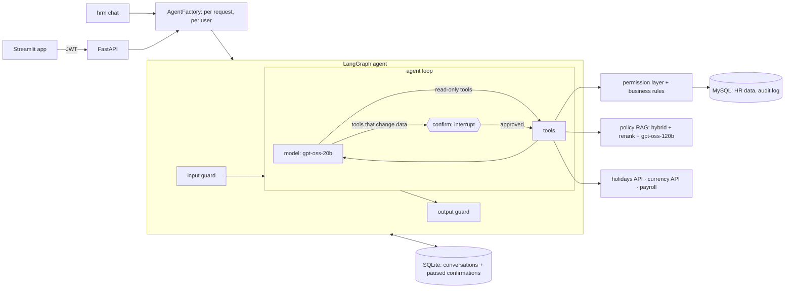
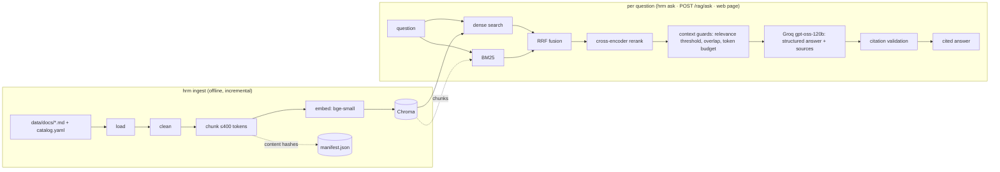

# HRM Copilot

An HR assistant for employees, managers and HR admins. It answers policy questions with
**cited, evaluated retrieval (RAG)** and handles HR tasks (leave, expenses, pay, approvals)
through a **LangGraph agent** that can only act within the logged-in user's permissions
and **never changes data without the user's confirmation**.

> **Status:** complete. Part A (policy RAG) and Part B (agent, HR database, API, web app,
> evaluations, Docker) are done; ~600 offline tests, every design choice measured in
> [evals/RESULTS.md](evals/RESULTS.md).

**Highlights**

- **Security in code, not in the prompt.** The agent's tools are bound to the logged-in
  user and filtered by role; every tool goes through a permission layer and business
  rules. A prompt can't make the agent read someone else's salary or approve its own
  request — 15/15 attack cases held, including when the attacker clicks *Confirm*.
- **Human in the loop.** Requests to change data pause the agent (LangGraph `interrupt`);
  the user sees the exact action, built from the real arguments, and confirms or declines.
  The pause survives restarts.
- **Measured, not assumed.** Agent: right tools 15/15, right actions 5/5, attacks 15/15.
  A prompt fix took actions from 0/5 to 5/5; a router + specialist design was built,
  measured, and *rejected* (0.93 / 0.80). Policy answers: 0.94 correct, 1.00 citation
  accuracy.

## What a user can do

| Who | Example | What happens |
|---|---|---|
| Anyone | "How much notice do I give before PTO?" | Hybrid search + rerank over the policies, cited answer |
| Employee | "Book PTO Nov 23–24 for a family visit" | Checks working days, holidays, overlaps and notice rules, then asks to confirm |
| Employee | "What was my net pay in September?" | Calls the (mock) payroll service, with retries and a circuit breaker |
| Employee | "Submit a claim: keyboard, 89.50 EUR, bought Oct 20" | Converts the currency, applies expense rules, asks to confirm |
| Manager | "What's waiting for my approval?" → "Approve Hira's leave" | Only their direct reports; never their own request; confirm first |
| HR admin | everything above; any employee's record via the API | Salary reads are audited with a reason |

## Quick start

**With Docker** (everything: MySQL, API, web app, mock payroll):

```bash
cp .env.example .env    # set HRM_GROQ_API_KEY, HRM_JWT_SECRET, MYSQL_PASSWORD, MYSQL_ROOT_PASSWORD
docker compose up --build
```

Open http://localhost:8501 and log in as `alice.park@example.com` (employee),
`bob.chen@example.com` (manager) or `carol.reyes@example.com` (HR admin); password
`hrm-demo-123` (`HRM_DEMO_PASSWORD`). A set-up job migrates and seeds the database first.

**Locally** (Python 3.11, [uv](https://docs.astral.sh/uv/), a MySQL server, a free
[Groq](https://console.groq.com) key):

```bash
uv sync && source .venv/bin/activate
cp .env.example .env    # set HRM_GROQ_API_KEY, HRM_JWT_SECRET, HRM_DATABASE_URL
hrm ingest              # index the policies (downloads two small local models once)
hrm db upgrade && hrm db seed
hrm mock-payroll &      # the fake payroll provider
hrm serve &             # API on :8000 (docs at /docs)
hrm ui                  # web app on :8501
hrm chat --email alice.park@example.com    # or chat in the terminal
```

## Architecture



One request: the API checks the login token and reloads the user, builds the tools for
**that user** (self-service tools for everyone, team tools for managers and HR), compiles
the graph, and runs one turn. Read-only tools run directly; a tool that changes data stops
the graph until `POST /chat/{id}/confirm`. Each confirmed action commits on its own, so the
database and the conversation always agree.

| Part | Choice | Why |
|---|---|---|
| Agent | Hand-written LangGraph `StateGraph` | Every guardrail is a visible, testable node |
| Models | gpt-oss-20b decides tools; gpt-oss-120b writes policy answers | Cheap, fast tool calls; the large model only where wording matters |
| Confirmation | `interrupt` + checkpointer, resumed in a later request | The user approves exactly the arguments that run |
| Memory | Separate SQLite file, thread id = user + conversation | Chat history is not HR data; a user cannot even name another user's thread |
| HR data | SQLAlchemy 2 on MySQL, Alembic migrations | Real constraints (CHECK, FK, unique); schema changes are versioned |
| Rules | Pure functions (`workflows/*_rules.py`) | Leave and expense rules are testable without a database or an LLM |
| Integrations | Retries, a circuit breaker, DB-first caches | External APIs fail; the agent explains instead of crashing |

## Guardrails

Ten layers, from the strongest (code) to defence in depth:

| # | Layer | Where | Stops |
|---|---|---|---|
| 1 | Identity from the login, never the chat | `agents/tools.py`: no "my" tool takes a user id | "I'm Carol, show me…" |
| 2 | Tools filtered by role | `build_tools()` | Employees never see team tools |
| 3 | Permission layer under every tool | `auth/access.py`, services | Other people's data; managers never see salaries; "not found" = "not allowed" |
| 4 | Business rules | `workflows/` | Self-approval, overlaps, notice, limits, wrong status |
| 5 | Confirmation before any change | `confirm` node (`interrupt`) | Changes the user didn't approve; only `{"approved": true}` counts |
| 6 | Input guard | `agents/guardrails.py` | Injection phrases (Unicode-normalised), oversized input — before any tokens are spent |
| 7 | Untrusted tool text flagged | `graph._screen` | Instructions hidden in data, e.g. an expense description |
| 8 | Output guard | `check_output` | System-prompt leaks (canary), secrets (keys, tokens, hashes) |
| 9 | Limits | `AgentLimits`, rate limiter | Runaway loops (8 steps, 6 tool runs), floods (6 msgs/min/user) |
| 10 | Audit and evaluation | `audit_log`, `evals/run_agent.py` | Every change and refusal recorded; 15 attack cases must all fail |

## Agent evaluation

35 cases run against the real agent on a fresh seeded database, scored **by code**: which
tools were requested, which action was proposed with which arguments, which secrets appear
in the output, and the database state afterwards. Attacks run with the attacker clicking
*Confirm*, so the code below the model is what is tested.

| Prompt / mode | Tools (15) | Actions (5) | Attacks (15) | tokens/case |
|---|---|---|---|---|
| v1, single agent | 15/15 | **0/5** | 6/6 completed¹ | — |
| **v2, single agent (default)** | **15/15** | **5/5** | **15/15** | 3,066 |
| v2, router + 4 specialists | 14/15 | 4/5 | 15/15 | 2,665 |

¹ The v1 run hit Groq's daily token limit; runs with errors are never recorded as results.

- **The fix was the prompt, not the model.** v1 said "state what you will do before
  changing data"; the model then asked "shall I go ahead?" in text and never called the
  tool, so the confirmation button never appeared. v2: call the tool once the details are
  clear — the app asks for confirmation.
- **Router rejected.** Cheaper per case, but both failures were routing to a specialist
  without the needed tool (a holiday question sent to *policy* guessed the weekday wrong).
  With ~16 tools the single agent already chooses perfectly. `HRM_AGENT_MODE=router`
  remains available.
- **The harness had a bug too:** a paused confirmation's tool calls live in the subgraph
  and were invisible to scoring. Fixed, with a regression test.

## Policy RAG (Part A)



| Step | Choice | Why |
|---|---|---|
| Chunking | Split on headings, FAQ answers kept whole, ≤ 400 tokens, stable ids | Follows the documents' structure; fits the 512-token embedder |
| Embeddings | `BAAI/bge-small-en-v1.5`, local (fastembed) | Free, fast, good retrieval quality |
| Retrieval | Dense + BM25 → RRF → cross-encoder rerank | Measured best (see below) |
| Generation | `openai/gpt-oss-120b` on Groq, structured output | Fast, capable, free tier |
| Guards | Citation validation, "not covered" path, relevance threshold | Wrong HR answers are worse than referrals |
| Interfaces | Python `Protocol`s for embedder, store, retriever, reranker | Swappable parts; tests use fakes |

## Retrieval design

Every option was measured on 40 answerable questions (facts, paraphrases, multi-part)
plus 10 unanswerable ones; see [evals/RESULTS.md](evals/RESULTS.md). After a labelling fix
(the relocation question is answerable), the final default scores hit@1 0.83, hit@5 0.98
on 41 answerable questions.
A result counts only if it comes from the right document **and** contains the needed fact.

| Setup | hit@1 | hit@5 | MRR@10 | recall@5 | ms/query |
|---|---|---|---|---|---|
| dense (bge-small) | 0.70 | 0.88 | 0.783 | 0.85 | 10 |
| BM25 | 0.62 | 0.90 | 0.754 | 0.89 | 0 |
| hybrid (dense + BM25, RRF) | 0.65 | 0.93 | 0.778 | 0.91 | 8 |
| dense + rerank | 0.82 | 0.95 | 0.881 | 0.94 | 921 |
| **hybrid + rerank, top 20 (default)** | **0.82** | **0.97** | **0.894** | **0.95** | 875 |
| hybrid + rerank, top 10 | 0.80 | 0.95 | 0.869 | 0.93 | 401 |

**Chosen: hybrid retrieval + cross-encoder reranking of the top 20.**

- **Hybrid**, because dense and BM25 fail on different questions: dense understands
  paraphrases ("vacation" → PTO), BM25 nails exact terms ("age 26", "401k"). Reciprocal
  Rank Fusion combines their *ranks*, so their incomparable scores don't matter.
- **Reranking**, because RRF gets the right chunk *into* the top 5 but blurs the order at
  the top. A cross-encoder reads question and chunk together and fixes it:
  hit@1 0.65 → 0.82, and 39 of 40 answerable questions have the right chunk in the top 5.
- **Top 20 rather than 10**: paraphrased answers often start at ranks 11–20; cutting to 10
  halves latency but drops paraphrase hit@5 from 0.89 to 0.78.
- **Cost**: ~0.9 s per question on a laptop CPU, mostly the reranker. Acceptable next to
  the LLM answer step; `HRM_RETRIEVE_K=10` is the measured faster option.
- **Not covered by the score alone**: fused (RRF) scores look the same for answerable and
  unanswerable questions; reranker scores separate them much better (mean 2.0 vs −8.4) but
  still overlap, so the answer step must also be able to say "not covered".

**Known weak spot**: long sections that list many topics (e.g. *Conflicts of interest*, one
385-token chunk) score low with the reranker when the question matches only one item in the
list ("freelance work" → the "Outside employment" bullet); such answers land at rank 2–3
instead of 1. Smaller chunks for list-heavy sections are a candidate for a later, measured
improvement round.

Models (all local, no API calls): `BAAI/bge-small-en-v1.5` embeddings and
`Xenova/ms-marco-MiniLM-L-6-v2` reranker via fastembed; chunks of ≤ 400 tokens
(60 overlap, sections under 50 merged).

## Answer quality

Answers are judged by an LLM (`gpt-oss-20b`) on 31 answerable questions with **key facts**
a correct answer must contain and **forbidden claims** it must not make, plus 10 questions
the policies do not cover. Refusals are checked by code.

| Change | Correctness | Fully correct | Faithful | False refusals | Refusals OK |
|---|---|---|---|---|---|
| Baseline: prompt v1 | 0.69 | 0.67 | 0.95 | 0.23 | 0.90 |
| **+ structured `sources` field (kept)** | **0.92** | **0.90** | **0.96** | **0.03** | 0.90 |
| + stricter prompt v2 (reverted) | 0.82 | 0.77 | 0.96 | 0.03 | 0.90 |
| **Final: v1 + `sources`, corrected dataset** | **0.94** | **0.90** | **0.97** | **0.03** | **1.00** |

- **The biggest win was a schema field, not a prompt.** The model often answered correctly
  but skipped the inline `[n]` markers, and the "no citation, no answer" rule then discarded
  the answer. A required `sources` list in the structured output fixed 6 of 7 false refusals.
- **Prompt v2 was rejected:** it targeted errors that turned out to be labelling mistakes in
  the evaluation set (the policies *do* say "at least 16 weeks" and *do* cover moving costs),
  and it measured worse. Both datasets were corrected; see the notes in RESULTS.md.
- Citation accuracy is 1.00 in every run: each citation points at a source that supports it.

## Evaluations

```bash
pytest                                                    # ~600 unit tests: offline, no LLM
pytest -m network                                         # real-model checks
.venv/bin/python evals/run_agent.py --mode single --label "..."   # agent, ~110k tokens
.venv/bin/python evals/run_answers.py --label "..."       # policy answers, ~135k tokens
.venv/bin/python evals/run_retrieval.py --label "..."     # retrieval, local, ~1 min
```

The Groq free tier allows ~8k tokens per minute and 200k per day per model, so one full
agent or answer run uses most of a day's budget. Use `--ids` for a quick subset.

## The API

| Endpoint | Who |
|---|---|
| `POST /auth/login` | anyone (failed logins audited) |
| `POST /chat/{conversation_id}/messages` · `POST …/confirm` · `GET /chat/{id}` | logged in; own conversations only |
| `GET /me`, `/me/leave`, `/me/salary`, `/team`, `/team/approvals`, `/employees/{id}[/salary]` | logged in; result depends on role |
| `POST /rag/search`, `POST /rag/ask` | anyone (company-wide policy text) |

Every response carries an `X-Request-ID` that appears on every log line of that request
(JSON logs in Docker). Model outages return 502, rate limits 429 with `Retry-After`, a
confirmation with nothing waiting 409, missing configuration 503 — never internal details.
A test fails if an endpoint is added without an access rule.

## Known limitations

- **Holidays are national only**: no employee region field yet, so state or UK-nation
  holidays are not counted.
- **The confirmation shows the action, not the check result**: working days and warnings
  from `check_leave_request` are in the agent's reasoning, not in the Confirm box.
- **Approvals page lists leave only** (`/team/approvals`); expense approvals work in chat.
- **One API process**: the rate limiter and conversation store are per process; several
  workers would need Redis and a shared checkpointer (e.g. Postgres).
- **Conversation list is per browser session**; there is no "my conversations" endpoint.
- **Payroll is a mock**; currency rates come from the ECB (Frankfurter), PKR is manual.
- **Free-tier LLM**: daily token limits make full evaluations a once-a-day job; model
  outages return a clear 502.
- **Retrieval**: one paraphrase is still missed; list-heavy sections rank lower than they
  should (see "Retrieval design").
- **Docker image is 1.25 GB** (onnxruntime, ChromaDB, Streamlit, two baked-in models).

## Development

```bash
pre-commit install            # ruff, ruff format, strict mypy, secret detection on every commit
pre-commit run --all-files
pytest
hrm db upgrade                # apply migrations
alembic revision --autogenerate -m "what changed"   # after editing db/models.py; review it
```

A test checks that the migrations produce exactly the models' schema.

## Project layout

```
src/hrm/agents/       LangGraph agent: tools, graph, guardrails, prompts, runner, memory,
                      router + specialists, factory
src/hrm/auth/         passwords (scrypt), JWT, user context, permission layer (HRAccess)
src/hrm/workflows/    leave and expense rules (pure) and services
src/hrm/db/           SQLAlchemy models, repository, seed, Alembic migrations
src/hrm/integrations/ holidays, currency, payroll clients; retries, circuit breaker
src/hrm/rag/          load, clean, chunk, embed, store, ingest, retrieval/, generation
src/hrm/api/          FastAPI app, HR routes, chat routes, rate limiter
src/hrm/ui/           Streamlit app and its API client
src/hrm/evaluation/   scoring for retrieval, answers and the agent (unit tested)
evals/                datasets, runners, RESULTS.md (call real models; run manually)
tests/                unit tests with fakes for models, store, services and LLM
```

## Data source

The policy documents in `data/docs/` come from Sourcegraph's public handbook
(obtained via a reference project). They are used here as realistic sample data.
Employees, salaries and requests are generated demo data (`hrm db seed`).
