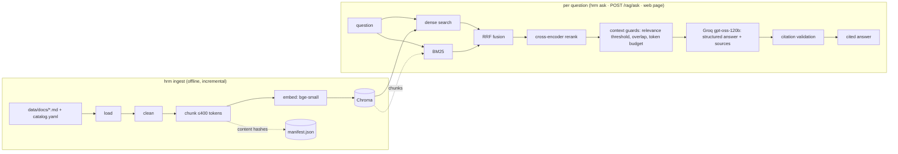

# HRM Copilot

An HR assistant that answers company-policy questions with **cited, evaluated
retrieval-augmented generation (RAG)**. Part B will add HR workflows (leave, expenses,
payroll) through role-protected agents.

> **Status:** Part A (policy RAG) is complete: ingestion, hybrid retrieval with reranking,
> grounded answers with validated citations, an HTTP API, a small web page, and offline
> evaluations for retrieval and answers. Part B is next.

**What it does well**

- Answers from five HR policies with **inline citations** that code checks against the
  retrieved sources; invented citations are removed.
- Says **"not covered, contact the People Team"** instead of guessing, and skips the LLM
  entirely for clearly off-topic questions.
- Every design choice is **measured**: [evals/RESULTS.md](evals/RESULTS.md) records each
  retrieval and answer change, including the ones that were rejected.

## Architecture



| Step | Choice | Why |
|---|---|---|
| Chunking | Split on headings, FAQ answers kept whole, ≤ 400 tokens, stable ids | Follows the documents' structure; fits the 512-token embedder |
| Embeddings | `BAAI/bge-small-en-v1.5`, local (fastembed) | Free, fast, good retrieval quality |
| Retrieval | Dense + BM25 → RRF → cross-encoder rerank | Measured best (see below) |
| Generation | `openai/gpt-oss-120b` on Groq, structured output | Fast, capable, free tier |
| Guards | Citation validation, "not covered" path, relevance threshold | Wrong HR answers are worse than referrals |
| Interfaces | Python `Protocol`s for embedder, store, retriever, reranker | Swappable parts; tests use fakes |

## Quick start

Requires Python 3.11 and a free [Groq](https://console.groq.com) API key.

```bash
uv sync                            # creates .venv with the exact versions from uv.lock (incl. dev tools)
source .venv/bin/activate
cp .env.example .env               # then set HRM_GROQ_API_KEY
hrm ingest                         # index the policies (downloads two small local models once)
hrm ask "Within how many days do I need to file an expense report?"
```

```text
You must file an expense report within 60 days of an eligible purchase. [1]

Sources:
  [1] home-office-and-stipends > (introduction)
```

## Using it

```bash
hrm ingest [--rebuild]                       # index policies; only changed docs are re-embedded
hrm search "can I freelance on the side?"    # ranked policy sections (no LLM)
hrm ask "How much notice do I give for PTO?" # cited answer
hrm serve                                    # HTTP API on :8000, interactive docs at /docs
hrm ui                                       # web page on :8501 (needs `hrm serve`)
hrm chunk-stats                              # chunk counts and token sizes per document
```

**HTTP API**

```bash
curl -s localhost:8000/rag/ask -H 'Content-Type: application/json' \
     -d '{"question": "Do I need approval before taking PTO?", "category": "time_off"}'
```

Returns `answer`, `found`, `citations` (document, section, quote) and per-step `timings`.
Every response carries an `X-Request-ID`; the same id is on every log line of that
request (retrieval, rerank, LLM), so a reported problem can be traced end to end.
LLM failures return 502 and missing configuration 503, without leaking internal details.

## Retrieval design

Every option was measured on 40 answerable questions (facts, paraphrases, multi-part)
plus 10 unanswerable ones; see [evals/RESULTS.md](evals/RESULTS.md). After a labelling fix
(the relocation question is answerable), the final default scores hit@1 0.83, hit@5 0.98
on 41 answerable questions.
A result counts only if it comes from the right document **and** contains the needed fact.

| Setup | hit@1 | hit@5 | MRR@10 | recall@5 | ms/query |
|---|---|---|---|---|---|
| dense (bge-small) | 0.70 | 0.88 | 0.783 | 0.85 | 10 |
| BM25 | 0.62 | 0.90 | 0.754 | 0.89 | 0 |
| hybrid (dense + BM25, RRF) | 0.65 | 0.93 | 0.778 | 0.91 | 8 |
| dense + rerank | 0.82 | 0.95 | 0.881 | 0.94 | 921 |
| **hybrid + rerank, top 20 (default)** | **0.82** | **0.97** | **0.894** | **0.95** | 875 |
| hybrid + rerank, top 10 | 0.80 | 0.95 | 0.869 | 0.93 | 401 |

**Chosen: hybrid retrieval + cross-encoder reranking of the top 20.**

- **Hybrid**, because dense and BM25 fail on different questions: dense understands
  paraphrases ("vacation" → PTO), BM25 nails exact terms ("age 26", "401k"). Reciprocal
  Rank Fusion combines their *ranks*, so their incomparable scores don't matter.
- **Reranking**, because RRF gets the right chunk *into* the top 5 but blurs the order at
  the top. A cross-encoder reads question and chunk together and fixes it:
  hit@1 0.65 → 0.82, and 39 of 40 answerable questions have the right chunk in the top 5.
- **Top 20 rather than 10**: paraphrased answers often start at ranks 11–20; cutting to 10
  halves latency but drops paraphrase hit@5 from 0.89 to 0.78.
- **Cost**: ~0.9 s per question on a laptop CPU, mostly the reranker. Acceptable next to
  the LLM answer step; `HRM_RETRIEVE_K=10` is the measured faster option.
- **Not covered by the score alone**: fused (RRF) scores look the same for answerable and
  unanswerable questions; reranker scores separate them much better (mean 2.0 vs −8.4) but
  still overlap, so the answer step must also be able to say "not covered".

**Known weak spot**: long sections that list many topics (e.g. *Conflicts of interest*, one
385-token chunk) score low with the reranker when the question matches only one item in the
list ("freelance work" → the "Outside employment" bullet); such answers land at rank 2–3
instead of 1. Smaller chunks for list-heavy sections are a candidate for a later, measured
improvement round.

Models (all local, no API calls): `BAAI/bge-small-en-v1.5` embeddings and
`Xenova/ms-marco-MiniLM-L-6-v2` reranker via fastembed; chunks of ≤ 400 tokens
(60 overlap, sections under 50 merged).

## Answer quality

Answers are judged by an LLM (`gpt-oss-20b`) on 31 answerable questions with **key facts**
a correct answer must contain and **forbidden claims** it must not make, plus 10 questions
the policies do not cover. Refusals are checked by code.

| Change | Correctness | Fully correct | Faithful | False refusals | Refusals OK |
|---|---|---|---|---|---|
| Baseline: prompt v1 | 0.69 | 0.67 | 0.95 | 0.23 | 0.90 |
| **+ structured `sources` field (kept)** | **0.92** | **0.90** | **0.96** | **0.03** | 0.90 |
| + stricter prompt v2 (reverted) | 0.82 | 0.77 | 0.96 | 0.03 | 0.90 |
| **Final: v1 + `sources`, corrected dataset** | **0.94** | **0.90** | **0.97** | **0.03** | **1.00** |

- **The biggest win was a schema field, not a prompt.** The model often answered correctly
  but skipped the inline `[n]` markers, and the "no citation, no answer" rule then discarded
  the answer. A required `sources` list in the structured output fixed 6 of 7 false refusals.
- **Prompt v2 was rejected:** it targeted errors that turned out to be labelling mistakes in
  the evaluation set (the policies *do* say "at least 16 weeks" and *do* cover moving costs),
  and it measured worse. Both datasets were corrected; see the notes in RESULTS.md.
- Citation accuracy is 1.00 in every run: each citation points at a source that supports it.

## Evaluations

```bash
pytest                                                   # ~280 unit tests: offline, no LLM calls
pytest -m network                                        # real-model checks (downloads models)
.venv/bin/python evals/run_retrieval.py --label "..."    # retrieval metrics, ~1 min, local
.venv/bin/python evals/run_answers.py --label "..."      # answer metrics, ~12 min, uses Groq
```

The Groq free tier allows about 8k tokens per minute and 200k per day per model; one full
answer evaluation uses ~55k (answers) + ~80k (judge) tokens. Use `--ids a03,a30` for a
quick subset. Runs with errors are never recorded.

## Known limitations

- One paraphrase ("I only started last month, can I take parental leave?") is still missed
  by retrieval; long, list-heavy sections (e.g. *Conflicts of interest*) rank lower than
  they should. Smaller chunks for list sections are the next measured experiment.
- Single-turn questions only; no conversation memory yet (Part B).
- No authentication yet; the API is meant for local use until Part B adds roles.
- Groq free-tier limits make the answer step fail with a clear 502 when the daily quota
  is used up.

## Development

```bash
pre-commit install          # once: run ruff + mypy on every commit
pre-commit run --all-files  # lint, format and type-check everything
pytest                      # unit tests (no network, no LLM calls)
```

## Project layout

```
src/hrm/core/       settings, structured logging, LLM factory, errors
src/hrm/rag/        load, clean, chunk, embed, store, ingest, retrieval/, generation, service, tool
src/hrm/api/        FastAPI app and request/response schemas
src/hrm/ui/         Streamlit page and its API client
src/hrm/evaluation/ scoring logic for the evaluations (unit tested)
evals/              datasets, runners and RESULTS.md (call the real models; run manually)
tests/              unit tests (fakes for models, store and LLM)
data/docs/          HR policy documents and catalog
```

## Roadmap: Part B

HR database (employees, roles, leave balances, expenses, audit log) · role-protected
tools (employee / manager / HR admin, salary masking) · public-holiday, currency and
mock-payroll APIs · leave and expense workflows with manager approval (LangGraph
human-in-the-loop) · router and specialist agents using `search_hr_policies` ·
authentication · Docker.

## Data source

The policy documents in `data/docs/` come from Sourcegraph's public handbook
(obtained via a reference project). They are used here as realistic sample data.
